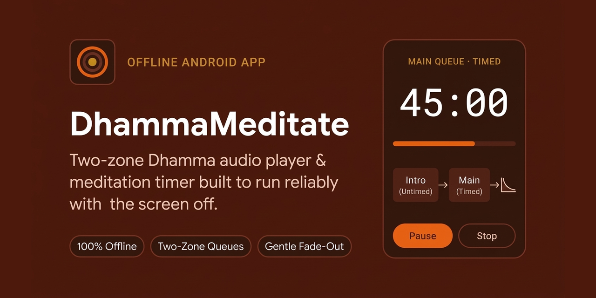

<div align="center">
  <h1>DhammaMeditate</h1>
  <p>Offline Android audio player and meditation timer for two-zone Dhamma sessions that run reliably with the screen off.</p>
  <p>
    
    
    
  </p>
  <p>
    
  </p>
</div>

## Quick Start

### Prerequisites
- JDK 17
- Android SDK (`compileSdk = 35`, `minSdk = 26`) with `ANDROID_HOME` configured, or Android Studio
- An Android device (API 26+) or emulator for installation

### Build & Run
```bash
# 1. Clone the repository
git clone https://github.com/htetoowai219/dhamma-meditate.git
cd dhamma-meditate

# 2. Run the unit test suite (44 tests, JVM-only)
./gradlew testDebugUnitTest

# 3. Build the debug APK
./gradlew assembleDebug

# 4. Install on a connected device or running emulator
./gradlew installDebug
```

The debug APK is written to `app/build/outputs/apk/debug/app-debug.apk`. Once installed, open the **Library** tab to import local audio files (`MP3`, `M4A/AAC`, `WAV`, `FLAC`, `OGG`), then create a session in the **Sessions** tab or run a single track directly.

## The Problem & Key Features

Standard media players and timer apps break down during long silent sits: Android revokes temporary document URIs, wall-clock timers drift during Doze mode, abrupt stops startle the listener, and lock-screen seek bars invite accidental skips. DhammaMeditate handles these failure modes locally without accounts or network access.

- **Two-Zone Session Queues & Intro Skip to Main:** Assemble reusable sessions with an optional untimed **Intro Queue** (0+ preparation tracks) and a required timed **Main Queue** (1+ tracks). Intro tracks play to completion while the countdown stays frozen; the timer starts automatically at the first Main track, or meditators can tap the in-app **Skip to Main** button during Intro playback to jump straight to Main track 1 and start the countdown immediately.
- **Custom Track Naming & Import Rename Flow:** Customize track display names immediately after single or multi-file imports (with **Skip all** or step-through renaming) or rename any track later from the Library. Custom names propagate live across Library, Session Editor, Player, active banner, and lock-screen metadata without touching the app-private audio file.
- **Strict Timer Validation:** Target duration cannot exceed the combined duration of the Main Queue. Removing a track or editing a queue below the current target snaps the timer down automatically with an inline notice and blocks invalid saves.
- **Off-Screen Timed Playback & Fade-Out:** Runs inside a foreground Media3 `MediaSessionService` (`mediaPlayback` type) backed by `SystemClock.elapsedRealtime()`. Over the final 10 seconds, volume ramps down on an exponential curve (`k = 3.5`) before resetting cleanly to `00:00`.
- **Restricted Controls:** Only **Start**, **Pause / Continue**, and **Stop & Reset** are exposed on the lock screen and headset remotes (with in-app **Skip to Main** visible strictly during Intro playback). Seeking, Main-queue skipping, and cross-session resume are blocked at the player boundary (`RestrictedMeditationPlayer`).
- **Pre-Session Distraction Check:** Checks Airplane Mode, Do Not Disturb, and ringer state via standard Android read APIs with zero extra permissions. If alerts are active, a dialog links directly to system settings and re-evaluates on return (`ON_RESUME`) while allowing **Continue anyway**.
- **Burmese Unicode & Flat UI:** Built with Jetpack Compose and flat Material 3 tokens (`tonalElevation = 0.dp`, `1dp` outlines, no gradients or shadows) and `1.45x–1.5x` line heights so stacked Myanmar diacritics do not clip.

## How It Works

Audio files imported through Android's document picker are probed with `MediaMetadataRetriever` and `MediaExtractor`, copied atomically into app-private storage (`filesDir/audio/`), and indexed in a local Room SQLite database (`dhamma_meditate.db`). Playback runs independently of UI lifecycle inside `MeditationPlaybackService`, which wraps `ExoPlayer` with `RestrictedMeditationPlayer` and polls a pure-Kotlin `MeditationTimerEngine`.

```text
[Compose UI: Sessions / Library / Editor / Player]
        |                                  ^
  (MediaController / Intents)       (PlaybackStateStore Flow)
        v                                  |
[MeditationPlaybackService (Foreground MediaSessionService)]
   |-- RestrictedMeditationPlayer --> ExoPlayer (App-private audio files)
   |-- MeditationTimerEngine -------> SystemClock.elapsedRealtime() + FadeCurve
   +-- Room (dhamma_meditate.db) ---> tracks, sessions, session_tracks
```

### Engineering Trade-Offs
- **Copy on Import Instead of Persistent URI Grants:** Copying selected audio into `filesDir/audio/` doubles local storage for imported files, but guarantees offline playback never fails when an OEM clears Storage Access Framework permissions or a user moves files in Downloads.
- **Monotonic Clock Over Wall Clock or Frame Counters:** `MeditationTimerEngine` derives remaining time from `SystemClock.elapsedRealtime()` (`250ms` normal ticks, `50ms` ticks during the 10-second fade window) so Doze sleep and NTP clock shifts cannot skew a 60-minute sit.
- **Single-Process Manual DI:** `AppContainer` wires Room, repositories, `AudioFileImporter`, and `PlaybackStateStore` directly in `DhammaMeditateApp` instead of pulling in Hilt/Dagger, keeping build times short and dependencies minimal.
- **Normative Shared Spec for Future iOS Parity:** Behavioral rules—data schema, timer validation, state machine transitions, fade-curve test vectors, and distraction policy—are documented in [docs/spec/dhammameditate-shared-spec.md](docs/spec/dhammameditate-shared-spec.md) so a native Swift + AVFoundation client can match Android behavior without code sharing.

<details>
<summary>Project Structure</summary>

```text
app/src/
├── main/
│   ├── AndroidManifest.xml          # 4 permissions: FOREGROUND_SERVICE, MEDIA_PLAYBACK, POST_NOTIFICATIONS, WAKE_LOCK
│   └── java/com/dhammameditate/
│       ├── data/
│       │   ├── importer/            # Atomic AudioFileImporter + format/duration probing
│       │   ├── local/               # Room v2 AppDatabase (MIGRATION_1_2), Track/Session DAOs & entities
│       │   └── repository/          # TrackRepository and SessionRepository (cascade-remove & timer clamping)
│       ├── di/                      # Manual AppContainer dependency graph
│       ├── playback/                # MeditationPlaybackService, MeditationTimerEngine, FadeCurve,
│       │                            # RestrictedMeditationPlayer, DistractionPolicy, TimerValidation
│       └── ui/                      # Compose screens (Sessions, Library, Editor, SessionPlayer, Player),
│                                    # DistractionCheckDialog, ActiveSessionBanner, flat Material 3 theme
└── test/java/com/dhammameditate/
    ├── playback/
    │   ├── DistractionPolicyTest.kt     # Airplane Mode / DND / ringer policy matrix
    │   ├── FadeCurveTest.kt             # Exponential curve and short-session boundary vectors
    │   ├── MeditationTimerEngineTest.kt # Intro-to-Main transitions, skipIntroToMain, pause/resume, fade
    │   └── TimerValidationTest.kt       # Cap clamping and validation rules
    └── ui/library/
        └── TrackNamingTest.kt           # Title validation & single/batch import rename flow

docs/
├── spec/dhammameditate-shared-spec.md  # Cross-platform contract for Android and future iOS parity
└── scope/                              # Roadmap (SCOPE.md) and phase architecture plans
```

</details>

<details>
<summary>Permissions & Local Storage</summary>

The manifest declares only four Android permissions and no network (`INTERNET`) permission:
- `FOREGROUND_SERVICE` and `FOREGROUND_SERVICE_MEDIA_PLAYBACK` — keep timed audio alive while the screen is off.
- `POST_NOTIFICATIONS` — display the media playback notification on Android 13+.
- `WAKE_LOCK` — prevent CPU suspension from interrupting audio playback or fade ticks.

All user data stays on-device (`android:allowBackup="false"`):
- **Database:** `dhamma_meditate.db` (Room SQLite v2)
- **Audio copies:** `context.filesDir/audio/<track-uuid>.<ext>`

</details>

## Common Commands

```bash
./gradlew testDebugUnitTest   # Run all 44 JUnit 4 unit tests
./gradlew lintDebug           # Run Android Lint checks
./gradlew assembleDebug       # Build debug APK (app/build/outputs/apk/debug/app-debug.apk)
./gradlew installDebug        # Build and install debug APK to connected device/emulator
```

## Next Up
- **Native iOS Client:** Implement the Swift + AVFoundation app directly from [docs/spec/dhammameditate-shared-spec.md](docs/spec/dhammameditate-shared-spec.md).
- **Configurable Fade-Out Window:** Allow adjusting the current fixed 10-second fade-out duration per session or globally.
- **Bilingual UI Localization:** Add full Burmese UI strings alongside English while preserving current Myanmar Unicode rendering rules.
